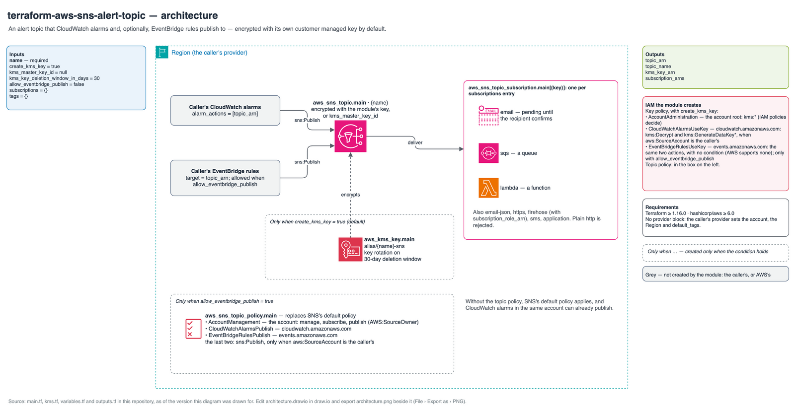

# Reference: resources, policies and permissions

Every resource the module can create, when it is created, and the names it gets.
`<name>` is `var.name`, `<account>` the caller's account ID and `<partition>` its
partition (`aws` in commercial Regions). The topic and the key also get `var.tags`; a
`Name` key in `var.tags` overrides the generated `Name` tag on both.

## Diagram

Source: [`architecture.drawio`](architecture.drawio).

## Resources

| Resource | Created when | Name or `Name` tag |
| --- | --- | --- |
| `aws_sns_topic.main` | Always | Topic `<name>`, tag `Name = <name>`. Encrypted with `aws_kms_key.main[0]`, else with `kms_master_key_id`, else not at all |
| `aws_kms_key.main[0]` | `create_kms_key` (default) | Description `Encrypts messages on the SNS topic <name>`, tag `Name = <name>-sns`; rotation on; deletion window `kms_key_deletion_window_in_days` |
| `aws_kms_alias.main[0]` | `create_kms_key` (default) | `alias/<name>-sns` |
| `aws_sns_topic_policy.main[0]` | `allow_eventbridge_publish` | — |
| `aws_sns_topic_subscription.main["<label>"]` | One per key of `subscriptions` | — (subscriptions take no tags) |
| `data.aws_caller_identity.current[0]`, `data.aws_partition.current[0]` | `create_kms_key` or `allow_eventbridge_publish` | Lookups for the policies below |

Check the addresses in a plan with `terraform plan | grep '# module'`.

## Key policy

The policy of `aws_kms_key.main[0]`, in this order. In a key policy, `Resource: "*"`
means the key itself.

| Sid | Principal | Actions | Condition | Present |
| --- | --- | --- | --- | --- |
| `AccountAdministration` | `arn:<partition>:iam::<account>:root` | `kms:*` | — | Always |
| `CloudWatchAlarmsUseKey` | Service `cloudwatch.amazonaws.com` | `kms:Decrypt`, `kms:GenerateDataKey*` | `StringEquals` `aws:SourceAccount` = `<account>` | Always |
| `EventBridgeRulesUseKey` | Service `events.amazonaws.com` | `kms:Decrypt`, `kms:GenerateDataKey*` | None (AWS supports none for EventBridge) | `allow_eventbridge_publish` |

`AccountAdministration` is the statement AWS puts in every default key policy. It lets
IAM policies in the account grant administration and use of the key; an IAM principal
without such a policy gets nothing from it.

## Topic policy

Without `allow_eventbridge_publish` there is no topic policy, and SNS's default policy
applies. With it, `aws_sns_topic_policy.main[0]` replaces the default with these
statements, each with `Resource` = the topic's ARN:

| Sid | Principal | Actions | Condition |
| --- | --- | --- | --- |
| `AccountManagement` | `arn:<partition>:iam::<account>:root` | `SNS:GetTopicAttributes`, `SNS:SetTopicAttributes`, `SNS:AddPermission`, `SNS:RemovePermission`, `SNS:DeleteTopic`, `SNS:Subscribe`, `SNS:ListSubscriptionsByTopic`, `SNS:Publish` | `StringEquals` `AWS:SourceOwner` = `<account>` |
| `CloudWatchAlarmsPublish` | Service `cloudwatch.amazonaws.com` | `sns:Publish` | `StringEquals` `aws:SourceAccount` = `<account>` |
| `EventBridgeRulesPublish` | Service `events.amazonaws.com` | `sns:Publish` | `StringEquals` `aws:SourceAccount` = `<account>` |

## Subscriptions

| Field | Values |
| --- | --- |
| Key | A label you choose. Shown in plan output and in the resource address, never secret |
| `protocol` | `email`, `email-json`, `https`, `sqs`, `lambda`, `firehose`, `sms`, `application`. `http` is rejected |
| `endpoint` | Address, URL, ARN or phone number, by protocol. Shown in plan output unless sensitive. Must not be empty |
| `subscription_role_arn` | Required for `firehose`, rejected for the others: the role SNS assumes to write to the delivery stream |

`email`, `email-json` and `https` subscriptions stay pending until the recipient or
endpoint confirms. Terraform cannot delete a pending subscription; deleting the topic
removes it.

## IAM granted by the module

The module creates no IAM role or policy. It grants access only through the key policy
and the topic policy above: to CloudWatch and EventBridge acting for the caller's
account, and to IAM principals in that account whose own policies allow it.

## Permissions the caller needs

To apply the module, the caller's credentials need SNS topic, topic-attribute,
tagging and subscription management (`sns:CreateTopic`, `sns:DeleteTopic`,
`sns:GetTopicAttributes`, `sns:SetTopicAttributes`, `sns:TagResource`,
`sns:UntagResource`, `sns:ListTagsForResource`, `sns:Subscribe`, `sns:Unsubscribe`,
`sns:GetSubscriptionAttributes`, `sns:SetSubscriptionAttributes`); KMS key, key-policy,
rotation, tagging, alias and key-deletion management (`kms:CreateKey`,
`kms:PutKeyPolicy`, `kms:GetKeyPolicy`, `kms:DescribeKey`, `kms:EnableKeyRotation`,
`kms:GetKeyRotationStatus`, `kms:TagResource`, `kms:UntagResource`,
`kms:ListResourceTags`, `kms:UpdateKeyDescription`, `kms:ScheduleKeyDeletion`,
`kms:CreateAlias`, `kms:DeleteAlias`, `kms:ListAliases`); and `sts:GetCallerIdentity`.
A `firehose` subscription also needs `iam:PassRole` on its `subscription_role_arn`.

Publishing to the encrypted topic needs `sns:Publish` on the topic and
`kms:GenerateDataKey*` and `kms:Decrypt` on the key.

## Requirements

| | Minimum | Why |
| --- | --- | --- |
| Terraform | 1.16.0 | The floor shared by this family of modules |
| `hashicorp/aws` | 6.0 | The current major version; nothing newer is needed |

Inputs and outputs are listed in the [README](../../README.md#inputs).
